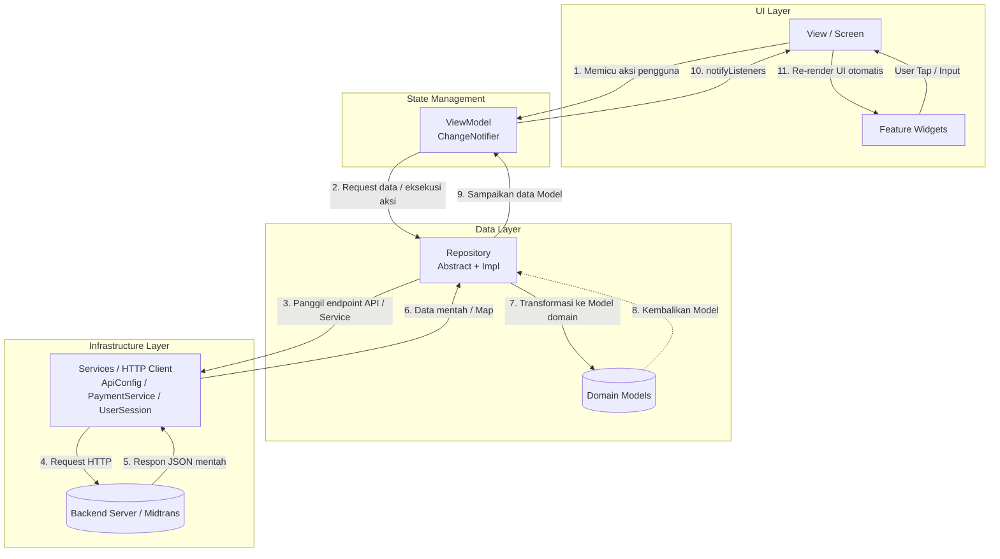

# Arsitektur Aplikasi Mobile Rumah Budaya Ratna (Feature-First MVVM + Repository Pattern)

Dokumen ini menjelaskan struktur arsitektur perangkat lunak yang diterapkan pada proyek Flutter `mobile-app-rbr` Rumah Budaya Ratna. Seluruh modul aplikasi menerapkan pola **Feature-First MVVM (Model-View-ViewModel) + Repository Pattern** untuk menjamin skalabilitas, keterbacaan, keteraturan kode, pemisahan tanggung jawab (*Separation of Concerns*), serta kemudahan pengujian (*testability*).

---

## 1. Pola Arsitektur yang Digunakan

Aplikasi mengombinasikan dua pola arsitektural industri standar:
1. **Feature-First (Modular Berbasis Fitur):** Kode dikelompokkan berdasarkan domain fungsionalitas pengguna (seperti `agenda`, `auth`, `booking_payment`, `chatbot`, `home`, `kedai_kopi`, `profil`, `pustaka`), bukan berdasarkan tipe teknis murni. Pendekatan ini membatasi ketergantungan antar-fitur (*loose coupling*) dan memudahkan navigasi kode seiring berkembangnya aplikasi.
2. **MVVM (Model-View-ViewModel) + Repository Pattern:**
   - **View** hanya berfokus pada rendering antarmuka pengguna grafis (UI) dan meneruskan event interaksi pengguna.
   - **ViewModel** mengelola state presentasi (*reactive state*) menggunakan `ChangeNotifier` dan `ListenableBuilder` bawaan Flutter.
   - **Repository** bertindak sebagai *Single Source of Truth* yang mengabstraksi komunikasi data antara ViewModel dan backend / service eksternal.
   - **Model** merepresentasikan entitas data bisnis murni (*pure data objects*).

---

## 2. Peta Struktur Direktori Aktual (`lib/`)

Struktur direktori aktual di bawah `lib/` mencakup lapisan global (`core/`) dan ke-8 fitur utama (`features/`):

```
lib/
├── main.dart                            # Titik masuk utama aplikasi (Entrypoint)
│
├── core/                                # Modul global & utilitas lintas fitur
│   ├── config/                          # Konfigurasi endpoint & URL API
│   │   └── api_config.dart
│   ├── di/                              # Dependency Injection / inisialisasi modul
│   │   └── injection.dart
│   ├── services/                        # Service jaringan, sesi pengguna, & payment gateway
│   │   ├── api_logger.dart
│   │   ├── payment_service.dart
│   │   └── user_session.dart
│   ├── theme/                           # Palet warna, tema, dan gaya visual bersama
│   │   └── colors.dart
│   ├── utils/                           # Helper & fungsi utilitas reusable
│   │   ├── app_validator.dart
│   │   └── currency_formatter.dart
│   └── widgets/                         # Widget umum yang digunakan di banyak fitur
│       ├── api_error_widget.dart
│       ├── mobile_frame.dart
│       └── user_avatar_widget.dart
│
└── features/                            # Modul fungsional berbasis fitur (Feature-First)
    │
    ├── agenda/                          # Fitur Agenda & Acara Budaya
    │   ├── models/
    │   │   └── event_model.dart
    │   ├── repositories/
    │   │   └── agenda_repository.dart
    │   ├── viewmodels/
    │   │   └── agenda_viewmodel.dart
    │   ├── views/
    │   │   └── agenda_view.dart
    │   └── widgets/
    │       └── agenda_card.dart
    │
    ├── auth/                            # Fitur Autentikasi & Akun Pengguna
    │   ├── models/
    │   │   └── auth_user_model.dart
    │   ├── repositories/
    │   │   └── auth_repository.dart
    │   ├── viewmodels/
    │   │   └── auth_viewmodel.dart
    │   ├── views/
    │   │   ├── forgot_password_view.dart
    │   │   ├── login_view.dart
    │   │   └── register_view.dart
    │   └── widgets/
    │       ├── auth_header_widget.dart
    │       ├── auth_success_dialog.dart
    │       ├── auth_text_field.dart
    │       └── google_sign_in_button.dart
    │
    ├── booking_payment/                 # Fitur Transaksi, QRIS, Virtual Account, & Struk
    │   ├── models/
    │   │   └── payment_model.dart
    │   ├── repositories/
    │   │   └── booking_payment_repository.dart
    │   ├── viewmodels/
    │   │   └── booking_payment_viewmodel.dart
    │   ├── views/
    │   │   ├── booking_checkout_view.dart
    │   │   ├── qris_payment_view.dart
    │   │   ├── riwayat_pesanan_screen.dart
    │   │   ├── struk_pembayaran_view.dart
    │   │   ├── struk_tiket_view.dart
    │   │   └── va_payment_view.dart
    │   └── widgets/
    │       ├── payment_option_card.dart
    │       └── price_summary_card.dart
    │
    ├── chatbot/                         # Fitur Asisten Kurator Budaya AI (Arunika Dwipantara)
    │   ├── models/
    │   │   └── chat_message_model.dart
    │   ├── repositories/
    │   │   └── chatbot_repository.dart
    │   ├── viewmodels/
    │   │   └── chatbot_viewmodel.dart
    │   ├── views/
    │   │   └── chatbot_view.dart
    │   └── widgets/
    │       └── chat_bubble_widget.dart
    │
    ├── home/                            # Fitur Beranda & Navigasi Utama
    │   ├── models/
    │   │   └── home_model.dart
    │   ├── repositories/
    │   │   └── home_repository.dart
    │   ├── viewmodels/
    │   │   └── home_viewmodel.dart
    │   ├── views/
    │   │   ├── beranda_view.dart
    │   │   └── main_screen.dart
    │   └── widgets/
    │       ├── home_banner_card.dart
    │       ├── home_header_bar.dart
    │       ├── home_popular_book_card.dart
    │       ├── home_quick_access_grid.dart
    │       ├── home_quote_card.dart
    │       └── home_upcoming_agenda_card.dart
    │
    ├── kedai_kopi/                      # Fitur Menu Kedai & Pemesanan Meja Dine-In
    │   ├── models/
    │   │   ├── cart_item_model.dart
    │   │   └── menu_model.dart
    │   ├── repositories/
    │   │   └── kedai_kopi_repository.dart
    │   ├── viewmodels/
    │   │   └── kedai_kopi_viewmodel.dart
    │   ├── views/
    │   │   ├── kedai_kopi_view.dart
    │   │   └── pesanan_meja_view.dart
    │   └── widgets/
    │       └── menu_item_card.dart
    │
    ├── profil/                          # Fitur Profil Anggota, Keamanan, FAQ, & Tentang RBR
    │   ├── models/
    │   │   └── profil_model.dart
    │   ├── repositories/
    │   │   └── profil_repository.dart
    │   ├── viewmodels/
    │   │   └── profil_viewmodel.dart
    │   ├── views/
    │   │   ├── pengaturan_akun_screen.dart
    │   │   ├── profil_view.dart
    │   │   ├── pusat_bantuan_screen.dart
    │   │   └── tentang_view.dart
    │   └── widgets/
    │       └── profil_menu_item.dart
    │
    └── pustaka/                         # Fitur Katalog Buku, Naskah Kuno, & Peminjaman
        ├── models/
        │   ├── book_model.dart
        │   ├── favorite_model.dart
        │   ├── loan_model.dart
        │   └── review_model.dart
        ├── repositories/
        │   └── pustaka_repository.dart
        ├── viewmodels/
        │   └── pustaka_viewmodel.dart
        ├── views/
        │   ├── book_detail_view.dart
        │   ├── facsimile_webview_view.dart
        │   ├── katalog_view.dart
        │   ├── koleksi_favorit_screen.dart
        │   ├── peminjaman_buku_screen.dart
        │   ├── pustaka_view.dart
        │   └── ulasan_diskusi_screen.dart
        └── widgets/
            ├── book_card_grid_item.dart
            ├── librarian_help_banner.dart
            ├── loan_card_widget.dart
            ├── pustaka_filter_chip.dart
            └── review_card_widget.dart
```

---

## 3. Tanggung Jawab Masing-Masing Lapisan

Setiap fitur memiliki 5 lapisan terisolasi dengan tanggung jawab yang tegas:

### A. Model (`models/`)
* **Peran:** Mendefinisikan struktur data entitas bisnis murni.
* **Karakteristik:** Berupa kelas Dart murni tanpa dependensi widget Flutter (`BuildContext`, `Widget`). Mengandung konstruktor `const`, serialisasi `fromJson`, dan deserialisasi `toJson`.

### B. Repository (`repositories/`)
* **Peran:** Bertindak sebagai *Single Source of Truth* untuk perolehan dan penyimpanan data.
* **Karakteristik:** Selalu diawali dengan `abstract class <Feature>Repository` sebagai kontrak interface, diiringi oleh implementasinya `class <Feature>RepositoryImpl implements <Feature>Repository`.
* **Tanggung Jawab:** Mengisolasi logika akses API HTTP (`http.get`, `http.post`), cache lokal, atau service platform, lalu memetakan respon mentah ke objek domain Model.

### C. ViewModel (`viewmodels/`)
* **Peran:** Mengelola state presentasi (*presentation state*) dan memproses aksi pengguna.
* **Karakteristik:** Menurunkan `ChangeNotifier` bawaan Flutter. Menyediakan getter untuk data, status loading (`isLoading`), dan pesan error (`errorMessage`).
* **Dependency Injection:** Menerima repository opsional di konstruktor (contoh: `<Feature>ViewModel({<Feature>Repository? repository}) : repository = repository ?? <Feature>RepositoryImpl();`) untuk memudahkan pembuatan unit test / mock.

### D. View (`views/`)
* **Peran:** Menampilkan antarmuka pengguna dan mendengarkan perubahan state dari ViewModel.
* **Karakteristik:** Berupa `StatelessWidget` atau `StatefulWidget` yang membungkus antarmuka dengan `ListenableBuilder(listenable: _viewModel, builder: ...)`.
* **Aturan Keras:** View **dilarang keras** memanggil HTTP client atau memproses bisnis data secara langsung; seluruh aksi didelegasikan ke metode ViewModel.

### E. Widgets (`widgets/`)
* **Peran:** Menyediakan komponen visual atomik dan modular yang digunakan secara berulang di dalam domain fitur tersebut (seperti kartu item, header formulir, dialog, dan filter chip).
* **Karakteristik:** Menerima data dan callback aksi secara eksplisit (*stateless/pure UI*).

---

## 4. Aliran Data Satu Arah (*Unidirectional Data Flow*)

Aplikasi mengadopsi alur data satu arah untuk memastikan bahwa status aplikasi dapat dilacak dan terhindar dari *side-effects* yang tidak diinginkan:



### Tahapan Alur Data:
1. **User Action:** Pengguna berinteraksi pada layar (misal: memilih filter, menekan tombol checkout, mengirim pesan chat).
2. **ViewModel Invocation:** View memanggil metode pada ViewModel terkait (misal: `viewModel.sendMessage(query)`).
3. **State Transition:** ViewModel mengubah state (misal: `_isLoading = true`) dan memicu `notifyListeners()`, membuat View menampilkan indikator loading.
4. **Repository Fetch:** ViewModel memanggil fungsi repository untuk mengambil data.
5. **Infrastructure Call:** Repository memanggil service atau client HTTP dengan endpoint dari `ApiConfig`.
6. **Data Mapping:** Data JSON hasil respon backend dipetakan menjadi objek Model domain murni oleh Repository.
7. **State Notification:** ViewModel menerima Model, memperbarui variabel state lokal, mengembalikan status loading (`_isLoading = false`), dan memanggil `notifyListeners()`.
8. **UI Re-render:** `ListenableBuilder` pada View mendeteksi pembaruan dan secara otomatis merender ulang widget sesuai state terbaru.

---

## 5. Panduan Pengembangan Fitur Baru

Untuk memastikan konsistensi kualitas dan struktur kode, patuhi pedoman berikut saat menambah fitur baru:

1. **Penamaan Folder Fitur:**
   - Gunakan huruf kecil pemisah *snake_case* di dalam `lib/features/` (contoh: `lib/features/koleksi_arsip/`).
2. **Struktur 5 Sub-Folder:**
   - Setiap fitur baru wajib memiliki 5 sub-folder berikut:
     * `models/` $\rightarrow$ file `<nama_model>.dart`
     * `repositories/` $\rightarrow$ file `<nama_fitur>_repository.dart`
     * `viewmodels/` $\rightarrow$ file `<nama_fitur>_viewmodel.dart`
     * `views/` $\rightarrow$ file `<nama_halaman>_view.dart` atau `<nama_halaman>_screen.dart`
     * `widgets/` $\rightarrow$ komponen visual khusus fitur tersebut
3. **Pola State Management:**
   - Gunakan `ChangeNotifier` pada ViewModel dan bungkus View dengan `ListenableBuilder`.
   - Hindari dependensi package state management luar jika belum terpasang di `pubspec.yaml` untuk mencegah konflik versi.
4. **Dependency Injection & Konstruktor View:**
   - ViewModel wajib mendukung opsional repository injection:
     ```dart
     class ContohViewModel extends ChangeNotifier {
       final ContohRepository repository;
       ContohViewModel({ContohRepository? repository})
           : repository = repository ?? ContohRepositoryImpl();
     }
     ```
   - View wajib menyediakan opsional ViewModel injection untuk keperluan testing:
     ```dart
     class ContohView extends StatefulWidget {
       final ContohViewModel? viewModel;
       const ContohView({super.key, this.viewModel});
       ...
     }
     ```
5. **Konvensi Impor:**
   - Gunakan impor absolut berbasis package: `package:mobile_app/...` daripada impor relatif bersarang panjang (`../../`).
   - Hindari impor sirkular (*circular dependency*) antar-fitur.
6. **Verifikasi Kualitas:**
   - Setelah penambahan atau pengubahan kode, jalankan pengujian kepatuhan sintaks dan unit test:
     ```bash
     flutter analyze lib/features/<nama_fitur>
     flutter test
     ```
   - Pastikan tidak ada pesan *error* atau *warning* sebelum melakukan *commit*.
