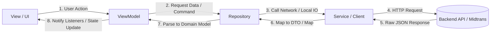

# Arsitektur Aplikasi Mobile Rumah Budaya Ratna (Feature-First MVVM + Repository Pattern)

Dokumen ini menjelaskan struktur arsitektur perangkat lunak yang diterapkan pada proyek Flutter `mobile-app-rbr` Rumah Budaya Ratna. Aplikasi ini menggunakan pendekatan **Feature-First MVVM (Model-View-ViewModel) + Repository Pattern** untuk menjamin skalabilitas, keterbacaan, keteraturan kode, pemisahan tanggung jawab (*Separation of Concerns*), serta kemudahan pengujian (*testability*).

---

## 1. Pola Arsitektur yang Digunakan

Aplikasi mengombinasikan dua pola arsitektural industri standar:
1. **Feature-First (Modular Berbasis Fitur):** Kode dikelompokkan berdasarkan domain fungsionalitas pengguna (seperti `auth`, `pustaka`, `kedai_kopi`, `booking_payment`), bukan berdasarkan tipe teknis murni. Pendekatan ini membatasi ketergantungan antar-fitur (*loose coupling*) dan memudahkan navigasi kode seiring berkembangnya aplikasi.
2. **MVVM (Model-View-ViewModel) + Repository Pattern:**
   - **View** hanya berfokus pada rendering antarmuka pengguna dan menangkap input interaksi.
   - **ViewModel** mengelola state presentasi dan logika tampilan layar.
   - **Repository** bertindak sebagai *Single Source of Truth* yang mengabstraksi komunikasi data antara ViewModel dan backend / penyimpanan lokal.
   - **Model** merepresentasikan entitas data bisnis murni.

---

## 2. Peta Struktur Direktori (`lib/`)

```
lib/
├── core/                                # Komponen global & modul lintas fitur
│   ├── config/                          # Konfigurasi aplikasi & base URL endpoint API
│   │   └── api_config.dart
│   ├── theme/                           # Definisi tema, palet warna, dan tipografi
│   │   └── colors.dart
│   ├── services/                        # Service global, network logger, session, & client
│   │   ├── api_logger.dart
│   │   ├── payment_service.dart
│   │   └── user_session.dart
│   ├── widgets/                         # Widget reusable yang dipakai secara global
│   │   ├── api_error_widget.dart
│   │   ├── mobile_frame.dart
│   │   └── user_avatar_widget.dart
│   └── models/                          # Model global bersama lintas modul
│       └── .gitkeep
│
├── features/                            # Modul fungsional berbasis fitur (Feature-First)
│   │
│   ├── auth/                            # Fitur Autentikasi Pengguna
│   │   ├── models/                      # Model kredensial & otentikasi
│   │   ├── repositories/                # Abstraksi komunikasi API login/register
│   │   ├── viewmodels/                  # State manajemen formulir autentikasi
│   │   ├── views/                       # Tampilan UI autentikasi
│   │   │   ├── login_view.dart
│   │   │   ├── register_view.dart
│   │   │   └── forgot_password_view.dart
│   │   └── widgets/                     # Widget khusus autentikasi
│   │
│   ├── home/                            # Fitur Navigasi Utama & Dashboard Beranda
│   │   ├── models/                      # Model ringkasan beranda
│   │   ├── repositories/                # Pengambil data highlight & banner
│   │   ├── viewmodels/                  # State perpindahan tab & dashboard
│   │   ├── views/                       # Layar beranda & wrapper frame
│   │   │   ├── main_screen.dart
│   │   │   └── beranda_view.dart
│   │   └── widgets/                     # Komponen visual beranda
│   │
│   ├── pustaka/                         # Fitur Pustaka, Naskah Kuno & E-Faksimili
│   │   ├── models/                      # Model buku, metadata naskah, & peminjaman
│   │   │   └── book_model.dart
│   │   ├── repositories/                # Abstraksi katalog buku & riwayat baca
│   │   ├── viewmodels/                  # State filter pencarian, rak, & koleksi
│   │   ├── views/                       # Halaman katalog, detail, & pembaca webview
│   │   │   ├── pustaka_view.dart
│   │   │   ├── katalog_view.dart
│   │   │   ├── book_detail_view.dart
│   │   │   ├── peminjaman_buku_screen.dart
│   │   │   ├── koleksi_favorit_screen.dart
│   │   │   ├── facsimile_webview_view.dart
│   │   │   └── ulasan_diskusi_screen.dart
│   │   └── widgets/                     # Kartu buku & filter rak buku
│   │
│   ├── kedai_kopi/                      # Fitur Kedai Kopi & Pemesanan Meja
│   │   ├── models/                      # Model menu kedai & keranjang transaksi
│   │   │   ├── menu_model.dart
│   │   │   └── cart_item_model.dart
│   │   ├── repositories/                # Abstraksi menu & antrean pesanan meja
│   │   ├── viewmodels/                  # State perhitungan belanja & item meja
│   │   ├── views/                       # Menu kedai & form meja dine-in
│   │   │   ├── kedai_kopi_view.dart
│   │   │   └── pesanan_meja_view.dart
│   │   └── widgets/                     # Kartu item menu kuliner
│   │       └── menu_item_card.dart
│   │
│   ├── booking_payment/                 # Fitur Pembayaran Transaksi Midtrans & Struk
│   │   ├── models/                      # Model transaksi pembayaran
│   │   ├── repositories/                # Abstraksi charge payment & verifikasi
│   │   ├── viewmodels/                  # State transaksi, QRIS, & VA status
│   │   ├── views/                       # Checkout, QRIS, Virtual Account, & struk
│   │   │   ├── booking_checkout_view.dart
│   │   │   ├── qris_payment_view.dart
│   │   │   ├── va_payment_view.dart
│   │   │   ├── struk_pembayaran_view.dart
│   │   │   ├── struk_tiket_view.dart
│   │   │   └── riwayat_pesanan_screen.dart
│   │   └── widgets/                     # Kartu opsi metode bayar & rincian tarif
│   │       ├── payment_option_card.dart
│   │       └── price_summary_card.dart
│   │
│   ├── agenda/                          # Fitur Agenda Acara Budaya
│   │   ├── models/                      # Model jadwal pertunjukan & tiket acara
│   │   │   └── event_model.dart
│   │   ├── repositories/                # Abstraksi komunikasi jadwal acara
│   │   ├── viewmodels/                  # State kalender & filter tanggal
│   │   ├── views/                       # Tampilan daftar event & detail agenda
│   │   │   └── agenda_view.dart
│   │   └── widgets/                     # Kartu event & pemilih tanggal
│   │
│   ├── chatbot/                         # Fitur Asisten Budaya Arunika (AI Chatbot)
│   │   ├── models/                      # Model percakapan kurator AI
│   │   ├── repositories/                # Abstraksi endpoint kecerdasan buatan
│   │   ├── viewmodels/                  # State message bubble & typing indicator
│   │   ├── views/                       # Layar percakapan interaktif Arunika
│   │   │   └── chatbot_view.dart
│   │   └── widgets/                     # Bubble chat & quick suggestion chips
│   │
│   └── profil/                          # Fitur Profil Anggota & Pengaturan Akun
│       ├── models/                      # Model profil anggota
│       ├── repositories/                # Sinkronisasi data identitas keanggotaan
│       ├── viewmodels/                  # State kartu anggota & preferensi
│       ├── views/                       # Halaman profil, bantuan, & tentang RBR
│       │   ├── profil_view.dart
│       │   ├── pengaturan_akun_screen.dart
│       │   ├── pusat_bantuan_screen.dart
│       │   └── tentang_view.dart
│       └── widgets/                     # Komponen visual profil pengguna
│
└── main.dart                            # Titik masuk utama aplikasi (Entrypoint)
```

---

## 3. Tanggung Jawab Masing-Masing Lapisan

Setiap lapisan dalam direktori memiliki batasan tugas yang terisolasi dan spesifik:

### A. Model (`models/`)
* **Tanggung Jawab:** Merepresentasikan objek data domain murni.
* Berisi definisi properti, tipe data immutable, konstruktor `const`, serialisasi `fromJson`, dan deserialisasi `toJson`.
* **Aturan:** Dilarang berisi logika UI atau dependensi widget Flutter (`BuildContext`, `Widget`).

### B. View (`views/`)
* **Tanggung Jawab:** Menampilkan antarmuka pengguna grafis (UI) kepada user.
* Merender tata letak (*layout*), menangani transisi animasi, mendengarkan perubahan state dari ViewModel, dan mengirimkan aksi pengguna (*event*) seperti ketukan tombol atau input teks.
* **Aturan:** Tidak boleh melakukan panggilan HTTP atau logika bisnis rumit secara langsung di dalam widget.

### C. ViewModel (`viewmodels/`)
* **Tanggung Jawab:** Mengelola state presentasi (*presentation state*) dan menjadi jembatan antara View dan Repository.
* Mengatur flag status seperti `isLoading`, `errorMessage`, dan list data yang siap ditampilkan.
* Memberitahu View saat terjadi perubahan data (*reactive state notification*, misal via `ChangeNotifier`, `ValueNotifier`, atau BLoC/Provider).

### D. Repository (`repositories/`)
* **Tanggung Jawab:** Menjadi *Single Source of Truth* untuk urusan perolehan dan penyimpanan data.
* Mengabstraksikan apakah data diambil dari server jarak jauh (REST API) atau penyimpanan lokal (cache/database).
* Memvalidasi dan memetakan respon data mentah ke objek `Model` domain yang bersih sebelum dikirimkan ke ViewModel.

### E. Service / DataSource (`core/services/`)
* **Tanggung Jawab:** Menangani komunikasi tingkat rendah (*low-level infrastructure*) dengan dunia luar.
* Meliputi HTTP Client, interceptor logging API, penyimpanan aman (`FlutterSecureStorage`), preferensi lokal (`SharedPreferences`), dan SDK pihak ketiga (Google Sign-In, Midtrans SDK).

### F. Widgets (`widgets/`)
* **Tanggung Jawab:** Menyediakan komponen visual yang modular dan dapat digunakan kembali (*reusable*).
* `core/widgets/` untuk komponen global lintas fitur (seperti bingkai perangkat `mobile_frame.dart` dan avatar `user_avatar_widget.dart`).
* `features/<fitur>/widgets/` untuk komponen atomik khusus domain terkait (seperti kartu menu `menu_item_card.dart` pada kedai kopi).

---

## 4. Aliran Data Satu Arah (*Unidirectional Data Flow*)

Aplikasi menerapkan aliran data satu arah agar alur logika dapat diprediksi, dilacak, dan bebas dari *side-effects*:



### Penjelasan Tahapan Alur Data:
1. **User Action:** Pengguna melakukan interaksi di layar (misalnya menekan tombol "Bayar Tiket" pada `BookingCheckoutView`).
2. **ViewModel Dispatch:** View memanggil metode yang relevan pada ViewModel terkait (misal: `checkoutTicket()`).
3. **Repository Invocation:** ViewModel menyetel status `isLoading = true` lalu memanggil kontrak method di `Repository`.
4. **Service Execution:** Repository memanggil `Service` (misal: `PaymentService.createCharge(...)`).
5. **API Call:** Service mengeksekusi panggilan HTTP POST/GET ke backend Rumah Budaya Ratna atau gateway pembayaran.
6. **Data Processing:** Respon dikembalikan, diparsing menjadi objek `Model` domain oleh Repository.
7. **State Update & Re-render:** ViewModel menerima Model, memperbarui variabel state lokal, mematikan status loading, dan memicu notifikasi pembaruan UI ke View.

---

## 5. Aturan Pengembangan Saat Menambah Fitur Baru

Untuk menjaga konsistensi arsitektur kode pada masa mendatang, setiap pengembang wajib mematuhi panduan berikut saat membuat fitur baru:

1. **Penamaan Folder Fitur:**
   - Gunakan format huruf kecil dengan pemisah *snake_case* di dalam `lib/features/` (contoh: `lib/features/pameran_seni/`).
2. **Sub-Folder Wajib:**
   - Setiap folder fitur baru wajib memiliki 5 sub-folder standar:
     * `models/`
     * `repositories/`
     * `viewmodels/`
     * `views/`
     * `widgets/`
   - Jika sub-folder belum memiliki implementasi berkas kode, cantumkan file `.gitkeep` agar struktur direktori tercatat dalam Git.
3. **Konvensi Impor (*Import Statements*):**
   - Selalu gunakan impor absolut berbasis package: `package:mobile_app/...` daripada impor relatif bersarang panjang (`../../`).
   - Hindari impor sirkular (*circular dependency*) antar-fitur.
4. **Distribusi Model & Widget:**
   - Jika sebuah model atau widget hanya digunakan di dalam satu domain fitur, wajib ditempatkan di dalam folder fitur tersebut.
   - Jika model atau widget digunakan bersama oleh lebih dari dua fitur yang berbeda secara substansial, letakkan di `lib/core/models/` atau `lib/core/widgets/`.
5. **Integritas Logika:**
   - Pisahkan penanganan error jaringan pada lapisan Service/Repository sehingga View menerima pesan error yang ramah pengguna (*user-friendly message*).
   - Selalu validasi kode menggunakan `flutter analyze` sebelum melakukan *commit* untuk memastikan integritas tipe data dan ketiadaan berkas yang rusak.
